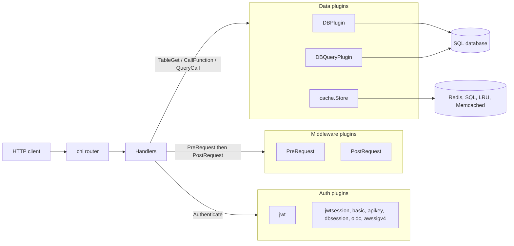
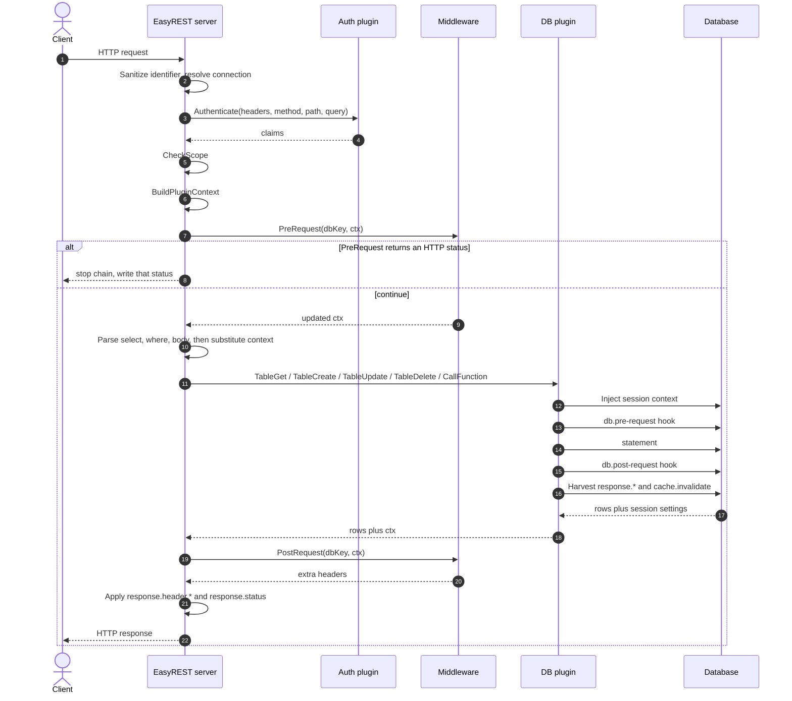
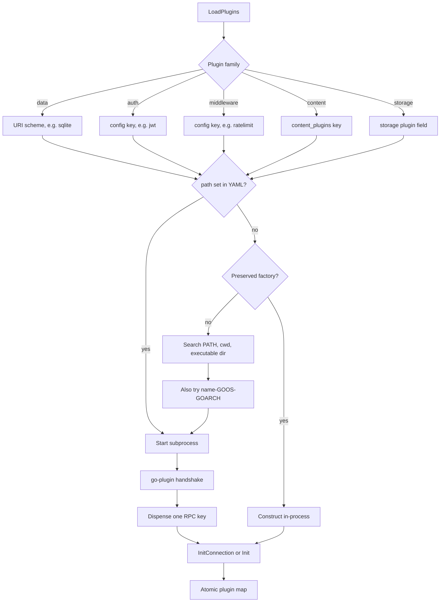
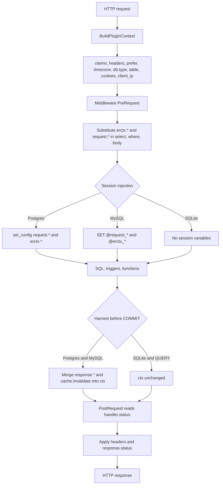

# EasyREST


<p align="center">
  
</p>

Turn a SQL database into a REST API. Authentication, request hooks, content types, storage, and every data backend are plugins: in-process in `easyrest-server`, or separate HashiCorp [go-plugin](https://github.com/hashicorp/go-plugin) processes in `easyrest-gateway`.

## Table of contents

- [What it is](#what-it-is)
- [Quickstart](#quickstart)
- [Architecture](#architecture)
- [Configuration](#configuration)
- [Plugins](#plugins)
- [Distributions and deployment](#distributions-and-deployment)
- [Development](#development)
- [License](#license)

## What it is

EasyREST is a small HTTP server that maps URL paths to database connections. Each named connection in the config becomes `/api/<name>/`. Table CRUD, RPC functions, a read-only `QUERY` method, and a generated Swagger 2.0 schema all go through the same pipeline: authenticate, check scopes, build a plugin context, run middleware, then call a data plugin.

The HTTP core never talks to a database driver itself. It sanitizes identifiers, parses query parameters into typed SQL fragments, and forwards those fragments to a plugin that owns the connection (in-process, or over go-plugin RPC).

SQLite, PostgreSQL, and MySQL can sit next to each other as `/api/app/`, `/api/analytics/`, and `/api/legacy/`. Auth, middleware, data, content, and storage are separate plugin families. A request can pass through auth, middleware, and data. Content and storage join when the handler parses a body, renders a response, or stores a file. Claims, headers, and `Prefer` values can be injected into the SQL session so triggers can set response metadata. Cache and rate limiting are ordinary middleware plugins.

The HTTP contract is in [internal/server/README.md](internal/server/README.md). How to write a plugin is in [plugin/README.md](plugin/README.md).

A full application can live in the `application` section: your own page on `GET /`, API versions, routes that call Postgres functions, file fields, and a cookie session. The SQL keeps the business rules and the row filters. [APPLICATION.md](APPLICATION.md) walks through one such app in [examples/application/](examples/application/).

## Quickstart

You need [Go 1.27.3+](https://go.dev/dl/) and Python 3 (for the seed script). Docker and a separate database server are not required.

```bash
make server
./create_local.sh
./bin/easyrest-server --config local_config.yaml
```

`[create_local.sh](create_local.sh)` writes `local.db` (10,000 users), `[local_config.yaml](local_config.yaml)`, and a JWT in `local_token.txt`.

```bash
export TOKEN=$(cat local_token.txt)

# List
curl -s "http://localhost:8080/api/crud/users/?select=id,name,email&ordering=id&limit=5" \
  -H "Authorization: Bearer $TOKEN"

# Filter
curl -s "http://localhost:8080/api/crud/users/?where.gt.age=40&where.eq.city=Berlin&limit=3" \
  -H "Authorization: Bearer $TOKEN"

# Swagger 2.0 schema for this connection (no auth)
curl -s "http://localhost:8080/api/crud/"
```

The same file also configures a read-only `QUERY` connection at `/api/query/`. See the curl examples printed by `create_local.sh`. Query parameters, paging, and `Prefer` are documented in [internal/server/README.md](internal/server/README.md).

## Architecture

### Where plugins plug in

Auth plugins run once per request, before the handler builds context. Middleware wraps the handler (`PreRequest` after context is built, `PostRequest` immediately before the body is written). Data plugins own SQL. Cache stores are not HTTP plugins. They sit behind the `cache-*` middleware. Content plugins parse and render bodies. Storage plugins keep uploaded bytes.



HTTP routes live in `[internal/server/server.go](internal/server/server.go)` (`SetupRouter`). Plugin maps are filled by `[LoadPlugins](internal/server/plugin_lifecycle.go)`.

### Request lifecycle

The order is fixed. The sequence below is the table handler in `[internal/server/table.go](internal/server/table.go)`. RPC and `QUERY` share auth, context, and middleware. Schema skips auth.



When `PreRequest` returns a non-nil status, the server writes that status immediately and skips both the handler and `PostRequest`. `PostRequest` cannot change the body. It can only add headers. `response.status` in the context overrides the handler status after `PostRequest` returns.

### How plugins are loaded

`easyrest-server` tries an in-process factory first (the preserved map registered in `[cmd/server/main.go](cmd/server/main.go)`, plus content and storage factories registered by the server package). `easyrest-gateway` does not register data, auth, or middleware factories. It does keep the shared content and storage factories. See [Distributions](#distributions-and-deployment).



Search and handshake: `[internal/server/plugin_load.go](internal/server/plugin_load.go)`. Names, RPC keys, and a `main` for each family are in [plugin/README.md](plugin/README.md#how-the-server-finds-a-binary).

A non-empty `path` always forces the subprocess path, even when a preserved factory exists.

### Context round-trip

The server builds a `map[string]any`, middleware may add hook names or headers, the server substitutes `erctx.*` / `request.*` into SQL fragments, and SQL plugins push that map into the session so triggers can write response metadata back.



`erctx.claims_sub` is the flattened form (dots and dashes become underscores). `request.claims.sub` walks the nested map. Flattening drops values that contain `;` or `--`.

Postgres and MySQL copy inbound keys (claims, headers, prefer, timezone, and similar) into the session. They skip `response.*`, `cache.*`, hook names `db.pre-request` / `db.post-request`, and any key that starts with `_`. A leading underscore is middleware-to-middleware state for that request. Those keys stay on the context map. HTTP handlers read `response.header.*` from there. SQL can set `response.headers` during the query. Harvest still copies that value back.

SQLite does not inject or harvest. `QUERY` never returns context, so it cannot harvest either. Dialect details and example SQL: [Postgres](plugins/data/postgres/README.md), [MySQL](plugins/data/mysql/README.md), [SQLite](plugins/data/sqlite/README.md).

## Configuration

`server.SetupApplication` loads defaults, then each `-config` file in order, then a YAML overlay from the flags that were actually passed. A field absent from a later document keeps its previous value. `SIGHUP` repeats that with the same files and overlay.

A file that matches the quickstart shape:

```yaml
port: "8080"
auth_plugins:
  jwt:
    settings:
      jwt_secret: "change-me"
plugins:
  crud:
    uri: sqlite:///var/lib/easyrest/local.db
```

Every field, including `application`, `internal_rpc`, CORS, OpenTelemetry, TLS, and `server:` timeouts, is in [internal/config/README.md](internal/config/README.md). Flags are `-config` (repeatable), `-port`, `-access-log`, and `-plugin-log`.

## Plugins

Settings and a YAML example live next to each plugin. The contract for a new binary is [plugin/README.md](plugin/README.md).

Auth:

- [jwt and oidc](plugins/auth/jwt/README.md)
- [jwtsession](plugins/auth/jwtsession/README.md)
- [basic](plugins/auth/basic/README.md)
- [apikey](plugins/auth/apikey/README.md)
- [dbsession](plugins/auth/dbsession/README.md)
- [awssigv4](plugins/auth/awssigv4/README.md)

Data:

- [sqlite](plugins/data/sqlite/README.md)
- [postgres](plugins/data/postgres/README.md)
- [mysql](plugins/data/mysql/README.md)

Cache stores, used by the cache middleware:

- [redis](plugins/data/redis/README.md)
- [memcached](plugins/data/memcached/README.md)
- [lru](plugins/data/lru/README.md)
- [sqlcache](plugins/data/sqlcache/README.md)

Middleware:

- [cache](plugins/middleware/cache/README.md)
- [ratelimit](plugins/middleware/ratelimit/README.md)
- [dbqueryhook](plugins/middleware/dbqueryhook/README.md)
- [response_headers](plugins/middleware/responseheaders/README.md)

Content:

- [json](plugins/content/json/README.md)
- [ndjson](plugins/content/ndjson/README.md)
- [xml](plugins/content/xml/README.md)
- [csv](plugins/content/csv/README.md)
- [form](plugins/content/form/README.md)
- [swaggerui](plugins/content/swaggerui/README.md)
- [yaml](cmd/content-yaml/README.md)

Storage:

- [local](plugins/storage/local/README.md)
- [memory](plugins/storage/memory/README.md)
- [s3](plugins/storage/s3/README.md)
- [dbglob](plugins/storage/dbglob/README.md)
- [static](plugins/storage/static/README.md)

`basic`, `apikey`, `jwtsession`, and `dbsession` have no `cmd/` binary. They exist only as preserved plugins inside `easyrest-server`.

## Distributions and deployment

| Binary | What you get |
| --- | --- |
| `easyrest-server` | HTTP core, sqlite/postgres/mysql, seven auth plugins (jwt, jwtsession, oidc, basic, apikey, dbsession, awssigv4), ratelimit, dbqueryhook, response_headers, six cache middlewares, YAML content, and S3 storage. PGO profile at `[cmd/server/default.pgo](cmd/server/default.pgo)` is picked up automatically. |
| `easyrest-gateway` | The same HTTP core. Content plugins json, ndjson, xml, csv, form, and html, plus storage local, memory, dbglob, and static, are still in-process. Data, auth, middleware, YAML, and S3 are external binaries on `PATH` or via `path:`. |

Both binaries share those content and storage factories because they live in the server package. `easyrest-server` adds the rest in `[cmd/server/main.go](cmd/server/main.go)`.

Release tags publish `easyrest-server-{linux,darwin}-{amd64,arm64}` and `easyrest-gateway-…`, plus a multi-arch image:

```bash
docker pull ghcr.io/onegreyonewhite/easyrest:latest
docker run --rm -p 8080:8080 -v $PWD/config.yaml:/config.yaml \
  ghcr.io/onegreyonewhite/easyrest:latest --config /config.yaml
```

The image is distroless, runs as non-root, and contains only `easyrest-server` (`[Dockerfile](Dockerfile)`).

TLS (`tls_enabled`, or both cert and key files) serves HTTP/2. Without TLS the server speaks h2c. `SIGHUP` reloads the same config files, restarts plugins, and rebuilds the chi router. `SIGINT`/`SIGTERM` shut down gracefully.

Optional pprof on `easyrest-server` only: `ER_PPROF_ADDR=:6060`.

A full MySQL + Postgres + Redis + Memcached stack for load tests lives in `[pgo/docker-compose.yml](pgo/docker-compose.yml)`. Details are in [pgo/README.md](pgo/README.md).

## Development

```bash
make            # all cmd/ binaries -> bin/easyrest-<dirname>
make server     # bin/easyrest-server (PGO auto if default.pgo exists)
make test       # go test ./... with coverage; needs plugin-sqlite, auth-jwt, and content-yaml on PATH
make bench
```

Integration tests under `[tests/](tests)` use in-process SQLite. They do not need Docker.

Profile-guided optimization: `make pgo-up`, `make pgo-collect` (writes `cmd/server/default.pgo`), `make pgo-verify`, `make pgo-down`. Details in `[pgo/README.md](pgo/README.md)`.

## License

Apache License 2.0. See [LICENSE](LICENSE) and [NOTICE](NOTICE).

Copyright 2025 Sergei Kliuikov
